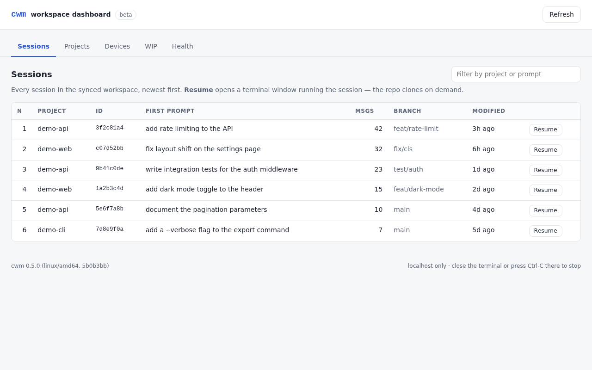
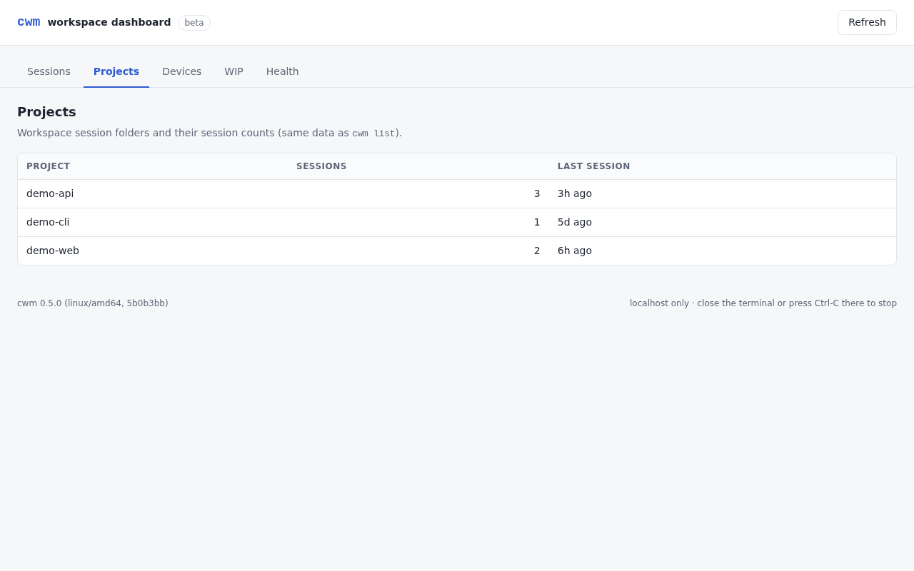
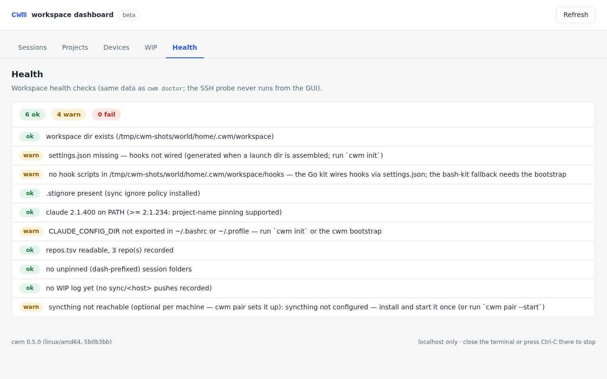
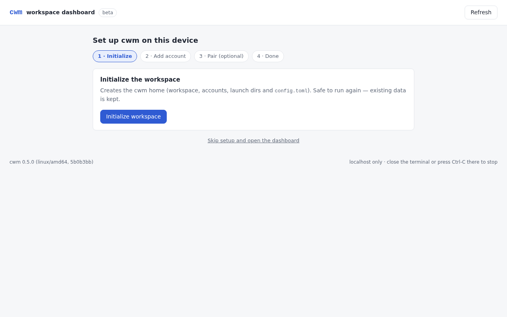

# cwm — Claude Workspace Manager

The all-in-one toolkit for your Claude Code setup: **accounts, workspace and devices
in one tool.** Sessions, memory, skills and MCP config in a private workspace you own —
switch Claude accounts freely, sync across your machines, resume anywhere.

> One tool: your accounts, your workspace, your devices.

## Why cwm

- **All-in-one** — everything account switchers do (multiple logins, switching,
  per-account usage, import) *plus* the layer they all lack: a portable, account-independent
  workspace with cross-device sync. No second tool needed.
- **Workspace-first, not account-first** — account switchers make *accounts* the primary
  object and bolt sharing on top. cwm inverts it: your **workspace** (sessions, memory,
  skills) is the primary object, and accounts are pluggable logins attached to it.
  Switch, share or rotate accounts — the workspace never notices.
- **Privacy, local-first** — your workspace lives in your own folder, not the default
  shared `~/.claude`. Nothing is uploaded anywhere; sync is peer-to-peer.
- **Cross-OS sync** — Linux and Windows read and write the *same* session folders via
  Syncthing P2P. Resume on the other machine exactly where you left off.
- **Repos on demand** — every repo you open is remembered in a small manifest; on another
  device `cwm <repo>` clones it from GitHub and drops you into the resume picker.

## The gap

| Need | ccam & other switchers | dotsync + ccsync + session-roam | raw Syncthing | **cwm** |
|---|---|---|---|---|
| Switch Claude accounts | yes | no | no | **yes** — accounts attached to your workspace |
| Same workspace on every account | partial (per-item sharing) | no | no | **yes** — workspace-first |
| Workspace private + relocatable | no | partial (dotfiles only) | no | **yes** |
| Sync across devices | no | partial (mac-first, path-fragile) | manual | **yes** (P2P, automated) |
| Same session folder on every OS | no | partial (path rewriting) | no — slugs differ per OS | **yes** (name pinning) |
| Repo clone-on-demand + resume | no | partial | no | **yes** (`repos.tsv` + `cwm <repo>`) |
| WIP handoff between devices | no | manual branches | no | **yes** (`sync/<host>` auto-push) |
| GUI for non-terminal users | no | no | web (sync only) | **yes** (`cwm gui`, beta) |
| Cloud service required | no | mixed | no | **no — P2P only** |

## Install

**Linux (Debian/Ubuntu):** download `cwm_<version>_linux_amd64.deb` (or
`_arm64.deb`) from [GitHub Releases](https://github.com/Mr-JoE1/cwm/releases)
and install it — `cwm` lands in `/usr/bin`, and `git` + `syncthing` are
pulled in as recommended packages:

```sh
sudo apt install ./cwm_<version>_linux_amd64.deb
```

**Linux (any distro):** download `cwm_<version>_linux_<arch>.tar.gz` (amd64
and arm64), unpack it, and put `cwm` on your `PATH`.

**Windows:** the release binaries aren't code-signed, so how you install them
decides whether SmartScreen shows a warning. In order of preference:

1. **tar.gz + the built-in `tar` (recommended).** Download
   `cwm_<version>_windows_amd64.tar.gz` (or `_arm64`) from Releases and
   extract it **from a terminal**, not with Explorer. Windows 10/11's `tar.exe`
   doesn't copy the Mark-of-the-Web onto `cwm.exe`, so no SmartScreen prompt:

   ```powershell
   tar -xzf .\cwm_<version>_windows_amd64.tar.gz
   ```

2. **zip (legacy).** If you extract the `.zip` with Explorer, `cwm.exe`
   inherits the download's Mark-of-the-Web, and SmartScreen will say
   *"prevented an unrecognized app"*. Check the zip against `checksums.txt`,
   then right-click it → **Properties** → **Unblock** *before* extracting (or
   run `Unblock-File` on it).

If Defender quarantines `cwm.exe` (a false positive common to new unsigned Go
binaries), see [docs/WINDOWS-SMARTSCREEN.md](docs/WINDOWS-SMARTSCREEN.md). It
covers every free fix and how to report the false positive.

**go install** (Go ≥ 1.25):

```sh
go install github.com/Mr-JoE1/cwm/cmd/cwm@latest
```

**From source:**

```sh
git clone https://github.com/Mr-JoE1/cwm.git
cd cwm
go build -o cwm ./cmd/cwm
```

**Prerequisites:** Claude Code ≥ 2.1.234 (verified by `cwm init` and `cwm doctor`),
git, an SSH key with access to your GitHub repos.
[Syncthing](https://syncthing.net) on each device for cross-device sync —
installing and pairing it is handled by [`cwm pair`](#device-sync-v03), no
manual Syncthing setup.

## Quick start

```sh
cwm init                 # scaffold ~/.cwm: workspace, accounts, launch, backups
cwm account add main     # attach a login — runs `claude auth login` into ~/.cwm/accounts/main
cwm open myproject       # clone on demand if missing, then the resume picker
```

Day to day:

```sh
cwm myproject            # short form of `cwm open myproject`
cwm myproject new|last   # fresh session / continue the latest one
cwm list                 # workspace projects: session counts + last-modified
cwm sessions             # every workspace session, newest first (--pick to resume)
cwm account list         # email, plan and login freshness per account
cwm --account work myproject   # launch under a specific account
cwm mcp add fetch -- npx -y @modelcontextprotocol/server-fetch
cwm wip                  # push dirty work to sync/<hostname> right now
cwm wip dirty            # repos with uncommitted work (before switching devices)
cwm doctor               # local health checks (--net adds an SSH probe)
```

The full first-run flow: `cwm init` → `cwm account add main` → `cwm open <repo>`.
Everything else (clone-on-demand, session resume, WIP branches) is automatic.

## Migration

Already have a setup? cwm imports it. Nothing is deleted, sources are left
untouched, and backups land in `~/.cwm/backups/`.

- **From the v0.1 bash kit** (`~/.claude-me` workspace): `cwm init --migrate`
  copies workspace items into `~/.cwm/workspace/`, imports your login as
  account `main`, and leaves `~/.claude-me` untouched as a backup.
- **From any Claude config dir** (default `~/.claude`): `cwm import --from <dir>`
  copies workspace items and imports the login as a new account.
- **From ccam**: `cwm import --ccam` reads `~/.local/share/ccam/profiles/*/`
  (each becomes an account with its credentials) and
  `~/.local/share/ccam/groups/<g>/` (shared items land in the workspace).

Add `--dry-run` to any migration command to print the plan without touching
the filesystem.

## How it works

```
+--------------+                        +----------------+
|   Linux      |   Syncthing P2P        |   Windows      |
| ~/.cwm/      |<---------------------->| %USERPROFILE%\ |
|  workspace/  |   (no cloud, ever)     |  .cwm\         |
|  projects/   |                        |  workspace\    |
|  skills/     |                        |  projects\     |
|  repos.tsv   |                        |  repos.tsv     |
+------+-------+                        +--------+-------+
       |                                         |
       |  cwm <repo> pins                        |
       |  CLAUDE_CODE_PROJECT_DIR_NAME=<repo>     |
+------v-----------------------+     +-----------v-----------------+
| ~/repos/<repo>               |<--->| ~\repos\<repo>              |
| cloned on demand from GitHub | SSH | cloned on demand from GitHub |
+------------------------------+     +-----------------------------+
```

Claude Code names session folders after the *absolute path* of the project,
slugified per OS — so the same repo gets `projects/-home-me-repos-alpha/` on
Linux and `projects/C--Users-me-repos-alpha/` on Windows, and cross-device
resume silently breaks. cwm pins `CLAUDE_CODE_PROJECT_DIR_NAME=<repo>` (Claude
Code ≥ 2.1.234), so every OS writes the same `projects/<repo>/` folder — no
path rewriting, ever.

### The account model (v0.2)

```
~/.cwm/
├── workspace/          # your content: projects/, skills/, memory, CLAUDE.md
│                       #   → synced P2P between your devices
├── accounts/<name>/    # logins only: .credentials.json + .claude.json
│                       #   → per machine, never synced by default
└── launch/<account>/   # assembled at launch: workspace items + that
                        #   account's credentials → set as CLAUDE_CONFIG_DIR
```

Every account attached to a workspace sees the *same* sessions, memory and
skills — that is the point of account independence. Credentials stay separate
per account, exactly as Claude Code expects. Multiple workspaces (e.g. `work`
vs `personal`) are supported by creating more than one.

## What syncs / what stays local

| Synced (your workspace) | Local (per machine) |
|---|---|
| `projects/` — sessions + memory | `accounts/<name>/` — `.credentials.json`, `.claude.json` |
| `skills/`, `agents/`, `commands/`, `rules/`, `plugins/`, `output-styles/` | `launch/<account>/` + generated `settings.json` (absolute hook paths) |
| `scheduled-tasks/`, `history.jsonl`, `CLAUDE.md` | `logs/`, `backups/`, caches, `shell-snapshots/`, `todos/` |
| `repos.tsv`, `mcp.json` | `debug/`, `statsig/`, OS junk |

The split is enforced by the `.stignore` that `cwm init` writes into the
workspace folder.

## Device sync (v0.3)

Two devices, four steps, zero Syncthing UI:

1. **Install Syncthing on both devices** and run it as a service —
   `sudo apt install syncthing` (then `systemctl --user enable --now syncthing`)
   on Linux, `winget install Syncthing.Syncthing` on Windows.
2. **On device A:** `cwm pair` — prints A's device ID and what to run on B.
3. **On device B:** `cwm pair <A-id> <name>`.
4. **On device A:** `cwm pair <B-id> <name>`.

Both sides must run the exchange once — then data flows. Every command is
idempotent; re-running is always safe. On a machine without the service,
`cwm pair --start` spawns one detached `syncthing serve --no-browser` for the
session — cwm never installs or supervises the daemon for you.

Check sync health at any time:

```sh
cwm devices
DEVICE       NAME     CONNECTED  ADDRESS             IN       OUT      COMPLETION
7A2FQK…      tower    yes        192.168.1.20:22000  412 MiB  38 MiB   100%
HX9B3C…      laptop   yes        192.168.1.21:22000  0 B      397 MiB  94%
```

With no peers yet it prints: *(no paired devices yet — run `cwm pair` on both
devices)*.

<details>
<summary>Syncthing troubleshooting</summary>

- **"syncthing config has no API key"** — Syncthing has never written its
  config. Start it once (`systemctl --user start syncthing` or plain
  `syncthing`) so it generates `config.xml`, then re-run `cwm pair`.
- **Service vs `--start`** — the service (step 1) is the recommended setup;
  cwm just finds the running instance. `cwm pair --start` is the fallback for
  machines without one: it spawns a single detached
  `syncthing serve --no-browser` — no supervision, no autostart.
- **Non-default endpoint** — GUI moved, TLS enabled, or API key kept
  elsewhere? Set `CWM_SYNCTHING_URL` and `CWM_SYNCTHING_API_KEY` to point
  cwm at the right endpoint.

</details>

## Find and resume sessions (v0.4)

Fresh device, workspace synced, nothing cloned yet — every session is already
browsable, because the rows come from the synced `projects/*/<uuid>.jsonl`
files themselves, not from any local clone:

```sh
cwm sessions
```

```text
N  project  id        first prompt                      msgs  branch       modified
1  alpha    3f2c81a4  fix the flaky e2e test on resume  42    feat/resume  4h ago
2  alpha    9b41c0de  refactor launcher pin logic       17    main         2d ago
3  beta     c07d52bb  draft API notes for sync hints    0                  2026-11-01
```

Resume one with a single command:

```sh
cwm sessions --pick      # print the table, pick a row interactively
cwm sessions --pick 1    # or resolve row 1 directly
```

The picked row opens through the same launcher as `cwm open`: the repo
**clones on demand** if it isn't on this machine yet, the session-folder name
is pinned, and `claude --resume <session-id>` starts with the full
conversation context. `cwm sessions <project>` filters to one project,
`--limit K` caps the rows, and `--json` emits one object per session for
scripting.

Before switching devices, check what hasn't been pushed yet:

```sh
cwm wip dirty
```

```text
repo   changed            last commit
gamma  1 changed file(s)  fix: guard nil account in launch
```

Only repos present under the repos root are scanned — a repo that isn't
cloned on this machine is clean by definition here. No rows means everything
is committed and safe to walk away from.

## Web GUI (v0.5, beta)

A dashboard and setup wizard are built into the same binary — no extra
install, no Node, nothing fetched from a CDN. It ships in every release
archive and in the `.deb` (`sudo apt install ./cwm_<version>_linux_amd64.deb`):

```sh
cwm gui                  # first free port in 47800-47809, opens your browser
cwm gui --port 47850     # pick the port yourself
cwm gui --no-open        # just print the URL (headless boxes, SSH sessions)
```



Five tabs — **Sessions**, **Projects**, **Devices**, **WIP**, **Health** —
show the same data as `cwm sessions`, `cwm list`, `cwm devices`,
`cwm wip dirty` and `cwm doctor`. Ctrl-C in the terminal stops the server.

| Projects | Health |
|---|---|
|  |  |

**Setup wizard.** On a device that is not set up yet (no workspace, or no
account), the page opens a four-step wizard instead of the tabs:

1. **Initialize** — runs the same `cwm init` code in-process (plain init, no
   migrate; safe to repeat) and shows the health checks afterwards.
2. **Add account** — opens a terminal window running
   `cwm account add <name>`; finish the Claude login there and the page picks
   the account up on its own (it polls every two seconds).
3. **Pair** (optional) — shows this device's Syncthing ID with a copy button
   and takes the other device's ID (dashes are fine). Skippable; needs a
   running Syncthing.
4. **Done** — on to the dashboard.



**Resume and pair from the dashboard.** Every Sessions row has a **Resume**
button: it opens a terminal window running
`cwm open <project> new --resume <id>` — exactly what `cwm sessions --pick N`
runs, so clone-on-demand and project-name pinning apply. The project must be
in the workspace manifest and the session ID must be one cwm discovered; the
browser cannot name an arbitrary command. The Devices tab has a **Pair
device** form that runs the same pairing code as `cwm pair <id> [name]`.

**Terminal windows.** Claude Code and the Claude login are interactive, so
the GUI never runs them in the browser — it opens a real terminal window:

| OS | terminal used |
|---|---|
| Linux | `$TERMINAL`, else the first of `x-terminal-emulator`, `gnome-terminal`, `konsole`, `xfce4-terminal`, `alacritty`, `kitty`, `xterm` |
| Windows | Windows Terminal (`wt.exe`) when installed, else a new console via `cmd /c start` |

The command goes to the terminal as an argument list, never as a shell string.
If the command fails, the window stays open until you press Enter so you can
read the error. The window is detached: stopping `cwm gui` does not close it.

**No terminal available** (a headless box over SSH, no `DISPLAY` /
`WAYLAND_DISPLAY`, or macOS, which is not supported yet): the action answers
`501` and the page shows the exact command with a **Copy** button. Run it in
any terminal; the wizard notices the new account on its own.

Security: the server binds to `127.0.0.1` only, and each launch gets a fresh
random token. The printed URL carries it once (`/?t=<token>`); the page
trades it for an HttpOnly, SameSite=Strict cookie and drops it from the
address bar. API calls without the cookie or an `Authorization: Bearer`
header get 401, requests with an unexpected `Host` header (DNS rebinding) get
403, and every action is a JSON `POST` that also requires an `X-CWM-CSRF`
header (the launch token, or the derived value the page fetches from
`/api/csrf` so the token itself never shows up in a response). All inputs are
checked against strict allowlists (account names
`^[a-z0-9][a-z0-9-]{0,31}$`, Syncthing device IDs, project and session names);
anything else gets 400. The account endpoints return identity fields only —
name, email, plan, default, last login — never credentials.

The same data is available for scripts — every view takes `--json`:

```sh
cwm list --json
cwm devices --json
cwm wip dirty --json
cwm doctor --json        # exit code unchanged: 1 when any check fails
```

## Roadmap

- **v0.1** — cwm rebrand, `cwm doctor`, MIT license, product README
- **v0.2** — Go core: single binary, configurable workspace dir, **account
  system** (add/switch/usage, launch-dir assembly), migration from `~/.claude`
  and ccam profiles
- **v0.3** — Syncthing pairing automated via its REST API (`cwm pair`,
  `cwm devices`)
- **v0.4** — session browser + WIP UX (`cwm sessions --pick`,
  `cwm wip dirty`)
- **v0.5** — embedded localhost web UI: `cwm gui` dashboard, setup wizard,
  resume/pair from the browser, `--json` on every view, `.deb` packages;
  CLI stays first-class *(shipped as beta — this release)*
- **v1.0** — stable CLI + GUI, complete docs, tagged long-term support

Decisions and their rationale: [docs/PLAN.md](docs/PLAN.md).

## Relationship to ccam

cwm is **not built on and does not depend on ccam** — it is an independent,
all-in-one toolkit. It borrows engineering patterns ccam proved (plan → backup →
mutate, atomic writes, doctor, fake-binary E2E tests) and covers everything
ccam does — multiple accounts, switching, per-account usage, import — as a
subset of its workspace model. ccam users can move over with
`cwm import --ccam`. Credit where due: ccam's account-switching design is
excellent; cwm started from the question "what if the workspace, not the
account, came first?"

> **Terms note:** whether using more than one Claude account is allowed depends
> on Anthropic's terms for each account. cwm never merges or hides account
> limits. Your call, your accounts.

## License

MIT — see [LICENSE](LICENSE). cwm is an unofficial community tool and is not
affiliated with or endorsed by Anthropic.

## Legacy: the v0.1 bash kit

<details>
<summary>Collapsed — the bash-kit install and how to move off it</summary>

cwm v0.1 shipped as a bash kit (`bin/`, `hooks/`, `templates/`,
`bootstrap.*`) using `~/.claude-me` as the workspace. It stays in-tree,
untouched and passing, as a fallback for one more release and is removed
in v1.0. Its sync setup relied on **manual Syncthing pairing** in the
Syncthing UI (and its old `ignore-delete` advice is withdrawn) — the Go
tooling pairs devices itself: see [Device sync (v0.3)](#device-sync-v03).

```sh
git clone git@github.com:Mr-JoE1/cwm.git ~/cwm && cd ~/cwm
./bootstrap.sh          # idempotent — safe to re-run
exec bash               # pick up new PATH + CLAUDE_CONFIG_DIR
```

Windows (PowerShell 5.1):

```powershell
git clone git@github.com:Mr-JoE1/cwm.git $env:USERPROFILE\cwm
cd $env:USERPROFILE\cwm
powershell -ExecutionPolicy Bypass -File .\bootstrap.ps1
# open a NEW terminal so PATH + CLAUDE_CONFIG_DIR take effect
```

Moving to the Go binary is one command: `cwm init --migrate` (see
[Migration](#migration) above). The bash kit keeps working until v1.0.

</details>
