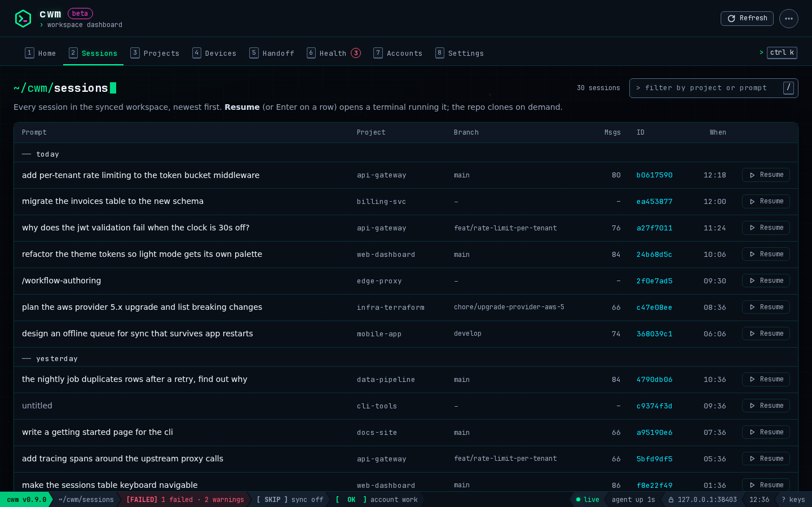
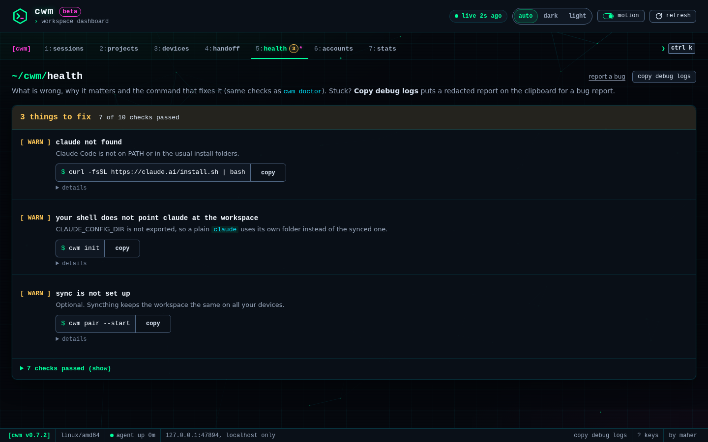
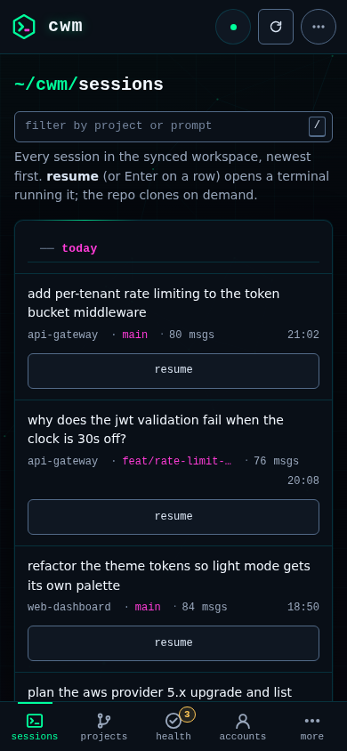
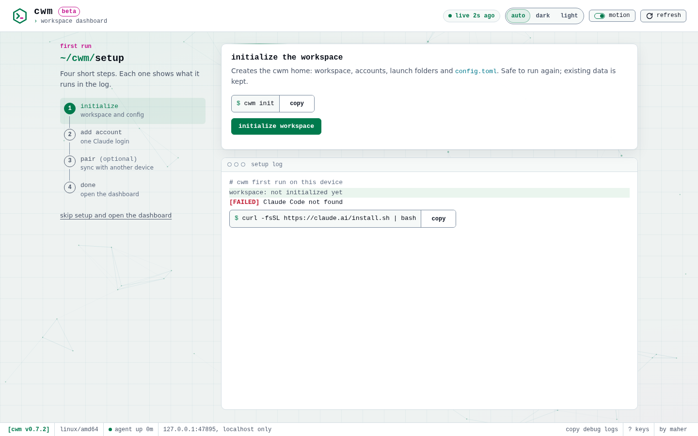

<div align="center">

<a href="https://github.com/Mr-JoE1/cwm">
  <picture>
    <source media="(prefers-color-scheme: dark)" srcset="docs/brand/cwm-logo-on-dark.svg">
    <source media="(prefers-color-scheme: light)" srcset="docs/brand/cwm-logo-on-light.svg">
    
  </picture>
</a>

<h3>Claude Workspace Manager</h3>

<p><strong>Your Claude Code workspace on every device, under any account.</strong></p>
<p>Sessions, memory, skills and MCP servers in a private folder you own,<br>synced peer-to-peer between your machines and independent of any login.</p>

[](https://github.com/Mr-JoE1/cwm/releases/latest) [](https://github.com/Mr-JoE1/cwm/actions/workflows/ci.yml?query=branch%3Amain) [](LICENSE) [](go.mod) [](https://github.com/Mr-JoE1/cwm/wiki/Installation)

<p>
  <a href="https://github.com/Mr-JoE1/cwm/wiki"><b>📖 Docs</b></a> ·
  <a href="#install"><b>⬇️ Install</b></a> ·
  <a href="https://github.com/Mr-JoE1/cwm/wiki/Dashboard-Tour"><b>🖥️ Dashboard</b></a> ·
  <a href="CONTRIBUTING.md"><b>🤝 Contributing</b></a> ·
  <a href="SECURITY.md"><b>🛡️ Security</b></a>
</p>

</div>

## Install

```sh
curl -fsSL https://mr-joe1.github.io/cwm/install.sh | sh        # Linux / macOS
```

```powershell
irm https://mr-joe1.github.io/cwm/install.ps1 | iex             # Windows (PowerShell)
```

Per user, with no sudo and no admin rights. Every download is SHA-256-checked against the release's `checksums.txt`, and nothing is installed if the check fails.

> [!TIP]
> Prefer a manual install? Archives for every platform, `.deb`, checksums, upgrading and uninstalling are in the **[Installation guide](https://github.com/Mr-JoE1/cwm/wiki/Installation)**.

<table>
  <tr>
    <td width="33%" valign="top">
      <h4>1 · The dashboard opens</h4>
      <p>The installer runs <code>cwm init</code>, sets up autostart at login and opens the local dashboard.</p>
    </td>
    <td width="33%" valign="top">
      <h4>2 · Add an account</h4>
      <p>The setup wizard walks you through the Claude login. Add more any time; they all share one workspace.</p>
    </td>
    <td width="33%" valign="top">
      <h4>3 · Pair &amp; resume</h4>
      <p>Optionally pair another device, then resume any session anywhere. Repos clone on demand.</p>
    </td>
  </tr>
</table>

<p align="center">
  <picture>
    <source media="(prefers-color-scheme: dark)" srcset="docs/img/gui-sessions-dark.png">
    <source media="(prefers-color-scheme: light)" srcset="docs/img/gui-sessions-light.png">
    
  </picture>
</p>

## Why cwm

Claude Code keeps your sessions, memory, skills and MCP setup in one config folder on one machine, tied to one login. Switching accounts splits your history, a new computer starts from zero, and copied sessions don't resume on another OS because their folder names come from OS-specific paths.

**cwm makes the workspace the main thing.** Your sessions, memory, skills, agents, commands and MCP servers live in a private folder you own. Claude accounts are logins that plug into it, so switching accounts changes nothing else. The folder syncs directly between your own devices with [Syncthing](https://syncthing.net), with no cloud in between, and session folders are pinned so Linux, Windows and macOS all resume the same conversations.

## Features

<table>
  <tr>
    <td width="33%" valign="top"><h4>🔀 Multiple accounts</h4><p>Add, list and switch Claude logins. Launch any project under any account with <code>--account</code>.</p></td>
    <td width="33%" valign="top"><h4>🔒 Private workspace</h4><p>Everything lives in <code>~/.cwm</code> (or wherever you choose), apart from any single login.</p></td>
    <td width="33%" valign="top"><h4>🔄 Device sync</h4><p>Peer-to-peer over Syncthing. <code>cwm pair</code> does the setup. Credentials never sync.</p></td>
  </tr>
  <tr>
    <td valign="top"><h4>🗂️ Session browser</h4><p>Every session from every device in one list. Resume in one click; the repo clones if it's missing.</p></td>
    <td valign="top"><h4>🖥️ Web dashboard</h4><p>Sessions, Projects, Devices, WIP, Health and Accounts (add, log in, set default, remove). Dark/light themes, live updates, phone layout.</p></td>
    <td valign="top"><h4>⚡ Always on</h4><p>A small per-user agent starts at login and serves a bookmarkable dashboard. No admin rights.</p></td>
  </tr>
  <tr>
    <td valign="top"><h4>🧩 MCP servers</h4><code>cwm mcp add</code> once, and the server is there on every device and every account.</td>
    <td valign="top"><h4>🌿 WIP handoff</h4><p>Uncommitted work is pushed to a <code>sync/&lt;host&gt;</code> branch when a session ends.</p></td>
    <td valign="top"><h4>🩺 Health checks</h4><code>cwm doctor</code> and the Health tab check Claude Code, the workspace, Syncthing and SSH.</td>
  </tr>
  <tr>
    <td valign="top"><h4>📦 One binary</h4><p>Linux, Windows and macOS on amd64 and arm64. No runtime, no Node, no CDN.</p></td>
    <td valign="top"><h4>📥 Bring your setup</h4><p>Import an existing Claude config folder, with a dry run and backups first.</p></td>
    <td valign="top"><h4>🛡️ Local only</h4><p>No telemetry, no cloud. The dashboard listens on localhost behind a token.</p></td>
  </tr>
</table>

## Screenshots

<table>
  <tr>
    <td width="68%" valign="top" align="center">
      <br>
      <sub><b>Health</b>: the <code>cwm doctor</code> checks at a glance</sub>
    </td>
    <td width="32%" valign="top" align="center" rowspan="2">
      <br>
      <sub><b>Mobile</b>: tables turn into cards</sub>
    </td>
  </tr>
  <tr>
    <td width="68%" valign="top" align="center">
      <br>
      <sub><b>Setup wizard</b>: init, account login and pairing</sub>
    </td>
  </tr>
</table>

## cwm vs. a manual setup

|  | Claude Code on its own | By hand (symlinks, copied folders, DIY sync) | **cwm** |
|---|---|---|---|
| Several accounts, one shared history | one config folder per account | symlink each item yourself | ✅ accounts attach to one workspace |
| Sessions synced across devices | — | set up sync and ignore rules yourself | ✅ `cwm pair`, ignore rules included |
| Resume on another OS | — (folder names differ per OS) | rename or rewrite paths | ✅ session folders pinned per repo |
| Credentials kept out of sync | n/a | easy to get wrong | ✅ stored outside the synced folder |
| Repos cloned on demand | — | — | ✅ from the synced repo list |
| Browse all sessions + dashboard | per project folder | — | ✅ `cwm sessions` and the web UI |

## Quick start

```sh
cwm account add main          # attach a Claude login (or the dashboard's Accounts tab)
cwm myproject                 # open ~/repos/myproject: clone on demand, then the resume picker
cwm sessions --pick           # every session, newest first: pick one to resume
cwm pair                      # pair this device with another one
cwm doctor                    # health checks
```

cwm finds Claude Code even when its folder isn't on `PATH` yet (right after its installer, for example), remembers it as `claude_path` in `config.toml`, and prints the command that puts it on `PATH`. To use a specific binary, set `CWM_CLAUDE=/path/to/claude`.

Every command takes `--help`, and every view takes `--json`. Full list: **[CLI Reference](https://github.com/Mr-JoE1/cwm/wiki/CLI-Reference)**.

## Documentation

<table>
  <tr>
    <td width="50%" valign="top">
      <h4>👤 <a href="https://github.com/Mr-JoE1/cwm/wiki/User-Guide">User Guide</a></h4>
      <a href="https://github.com/Mr-JoE1/cwm/wiki/Getting-Started">Getting started</a> ·
      <a href="https://github.com/Mr-JoE1/cwm/wiki/Installation">Installation</a> ·
      <a href="https://github.com/Mr-JoE1/cwm/wiki/First-Time-Setup">Setup wizard</a> ·
      <a href="https://github.com/Mr-JoE1/cwm/wiki/Device-Sync">Device sync</a> ·
      <a href="https://github.com/Mr-JoE1/cwm/wiki/Auto-Start-and-Service">Autostart</a> ·
      <a href="https://github.com/Mr-JoE1/cwm/wiki/Troubleshooting">Troubleshooting</a> ·
      <a href="https://github.com/Mr-JoE1/cwm/wiki/FAQ">FAQ</a>
    </td>
    <td width="50%" valign="top">
      <h4>🛠 <a href="https://github.com/Mr-JoE1/cwm/wiki/Developer-Guide">Developer Guide</a></h4>
      <a href="https://github.com/Mr-JoE1/cwm/wiki/Architecture">Architecture</a> ·
      <a href="https://github.com/Mr-JoE1/cwm/wiki/Building-and-Testing">Building &amp; testing</a> ·
      <a href="https://github.com/Mr-JoE1/cwm/wiki/Local-API-Reference">Local API</a> ·
      <a href="https://github.com/Mr-JoE1/cwm/wiki/Security-Model">Security model</a> ·
      <a href="https://github.com/Mr-JoE1/cwm/wiki/Decision-Log">Decision log</a> ·
      <a href="https://github.com/Mr-JoE1/cwm/wiki/Roadmap">Roadmap</a>
    </td>
  </tr>
</table>

## Privacy & security

- **Local only, no telemetry.** No server, no analytics, nothing phones home. Sync runs directly between your devices.
- **Credentials stay on the machine.** Logins live outside the synced folder, and the dashboard API never returns them.
- **Localhost dashboard.** Bound to `127.0.0.1`, with a per-user token, CSRF checks on every action, a DNS-rebinding guard and strict input allowlists.
- **Verified installs.** The installers check SHA-256 against `checksums.txt` and refuse to install on a mismatch.

Details: [Privacy & Data](https://github.com/Mr-JoE1/cwm/wiki/Privacy-and-Data) · [Security Model](https://github.com/Mr-JoE1/cwm/wiki/Security-Model). Found a vulnerability? Please report it privately, as described in **[SECURITY.md](SECURITY.md)**.

## Contributing

Bug reports, ideas, docs fixes and pull requests are welcome. For a bug, attach the redacted debug report: **Copy debug logs** in the dashboard (Health tab) or `cwm debug --copy`. Start with **[CONTRIBUTING.md](CONTRIBUTING.md)**, and please follow the [Code of Conduct](CODE_OF_CONDUCT.md).

## License

MIT, see [LICENSE](LICENSE). cwm is an unofficial community tool, not affiliated with or endorsed by Anthropic.

---

<div align="center">

**If cwm saves you time, please [⭐ star the repo](https://github.com/Mr-JoE1/cwm/stargazers).** It helps others find it.

Designed &amp; developed by **Maher**<br> [GitHub](https://github.com/Mr-JoE1) · [X](https://x.com/MrJ0_3) · [LinkedIn](https://www.linkedin.com/in/mr-joe1)

</div>
